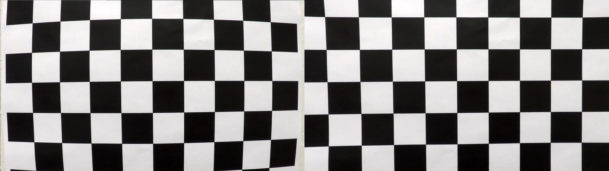
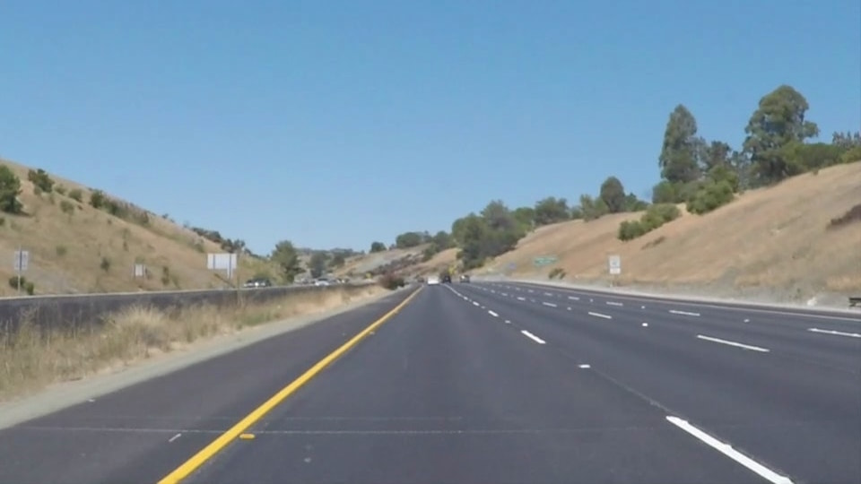
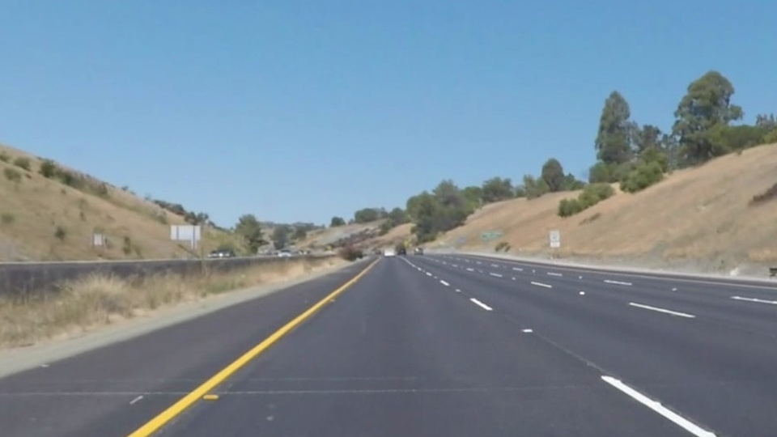
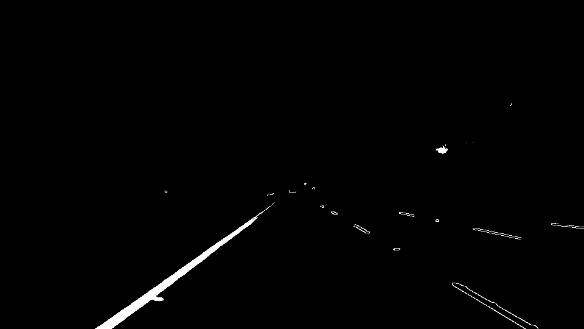
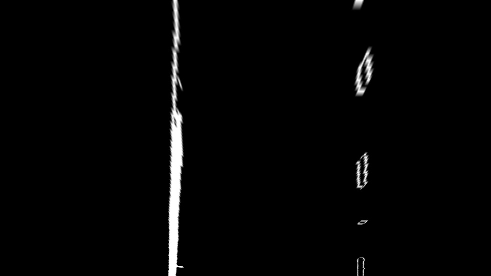
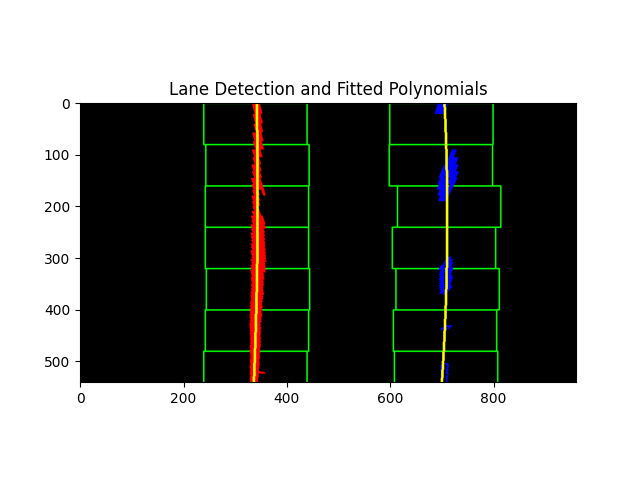
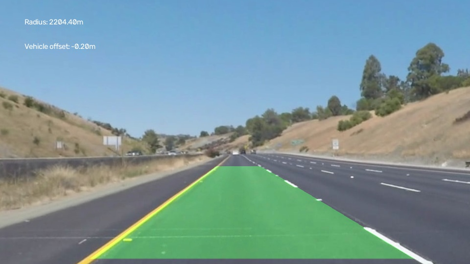

## Writeup Template

### You use this file as a template for your writeup.

---

**Lane Finding Project**

The goals / steps of this project are the following:

* Compute the camera calibration matrix and distortion coefficients given a set of chessboard images.
* Apply a distortion correction to raw images.
* Use color transforms, gradients, etc., to create a thresholded binary image.
* Apply a perspective transform to rectify binary image ("birds-eye view").
* Detect lane pixels and fit to find the lane boundary.
* Determine the curvature of the lane and vehicle position with respect to center.
* Warp the detected lane boundaries back onto the original image.
* Output visual display of the lane boundaries and numerical estimation of lane curvature and vehicle position.

[//]: # (Image References)

[image1]: ./examples/undistort_output.png "Undistorted"
[image2]: ./test_images/test1.jpg "Road Transformed"
[image3]: ./examples/binary_combo_example.jpg "Binary Example"
[image4]: ./examples/warped_straight_lines.jpg "Warp Example"
[image5]: ./examples/color_fit_lines.jpg "Fit Visual"
[image6]: ./examples/example_output.jpg "Output"
[video1]: ./project_video.mp4 "Video"

---

### Writeup / README

#### 1. Provide a Writeup that includes all the rubric points and how you addressed each one.

You're reading it!

### Camera Calibration

#### 1. Briefly state how you computed the camera matrix and distortion coefficients. Provide an example of a distortion corrected calibration image.

The camera calibration code is located in the `main()` function (lines 115-153).

Calibration uses the chessboard images from the `camera_cal/` folder. The board has 10x7 squares, i.e. 9x6 inner corners, so `chessboard_corners = (9, 6)`.

First, an array `matrix` is created with the 3D coordinates of the board corners in the real world, in the form (0,0,0), (1,0,0), (2,0,0) ... (8,5,0). The board is assumed to be flat and to lie in the z = 0 plane, so these coordinates are the same for every image.

Then, for each image in `camera_cal/`:
1. the image is loaded and converted to grayscale (`cv2.cvtColor`),
2. the board corners are found using `cv2.findChessboardCorners`,
3. if all corners are successfully found, the 3D points (`matrix`) are added to the `matrix_points` list, and the detected 2D corner coordinates in the image are added to the `image_points` list.

Once the points from all images have been collected, `cv2.calibrateCamera(matrix_points, image_points, ...)` is called, which returns the camera matrix (`camera_matrix`) and the distortion coefficients (`dist_coeffs`). 
To verify the calibration, `cv2.undistort` with the obtained parameters was applied to the image `camera_cal/calibration1.jpg`. On the left is the original image, and on the right is the image with the distortion removed. In the original image the board lines are curved toward the edges, while in the corrected image they are straight:

### Pipeline (single images)

#### 1. Provide an example of a distortion-corrected image.

This part of the code is located in the `main()` function (lines 156-161).

After obtaining the camera matrix (`camera_matrix`) and the distortion coefficients (`dist_coeffs`) from the calibration, I used them to correct the road image. I loaded the test image `test_images/whiteCarLaneSwitch.jpg` and called `cv2.undistort` on it with these two parameters. The resulting image `undistorted_img` is then used in all subsequent steps (binarization, perspective transform and lane detection).

The difference between the original and the corrected road image is not as noticeable as with the chessboard, but it is most visible at the edges of the image, where the distortion is greatest.
Original road image:

Example of the road image after distortion removal:

#### 2. Describe how (and identify where in your code) you used color transforms, gradients or other methods to create a thresholded binary image.  Provide an example of a binary image result.

This part of the code is located in the `main()` function (lines 167-187).

To obtain the binary image, I combined two methods: edge detection (gradient) using the Canny algorithm and color thresholding in the LAB color space.

**1. Canny edge detection**

I first converted the undistorted image (`undistorted_img`) to grayscale, since changes in pixel intensity are easier to detect that way. I then applied `cv2.Canny` with a lower threshold of 300 and an upper threshold of 400. I set the thresholds relatively high so that only strong edges (the lines on the road) are extracted, with as little noise as possible. Canny finds white lines well, because they stand out clearly against the dark asphalt.

**2. LAB color space - B channel**

Yellow lines are less visible in the grayscale image, so I extracted them separately using color. I converted the image to the LAB color space (`cv2.COLOR_BGR2LAB`) and took only the B channel, since it represents the yellow-blue relationship. On the B channel I applied a threshold from 150 to 255, so that pixels in that range (yellow color) get the value 1, and all others 0. The result is the image `binary_b`.

**3. Combining**

Finally, I merged both results: a pixel in the `combined_binary` image has the value 1 if it was detected by the Canny algorithm or if it belongs to the yellow color from the B channel. This way both white and yellow lines are obtained in a single image. For display and saving, the image is multiplied by 255 so that pixels with the value 1 become white.

Example binary image (the yellow line on the left was obtained from the B channel, and the white dashed lines on the right using the Canny algorithm):

#### 3. Describe how (and identify where in your code) you performed a perspective transform and provide an example of a transformed image.

The transform itself is in the `PerspectiveTransform()` function (lines 7-11), while the point selection and its call are in the `main()` function (lines 194-212).

The `PerspectiveTransform(img, src, dst)` function takes an image and two sets of 4 points each. Using `cv2.getPerspectiveTransform`, it computes the transformation matrix that maps the `src` points to the `dst` points, and then applies that matrix to the whole image using `cv2.warpPerspective`. The output image is the same size as the input.

I selected the `src` points manually on the road image so that they enclose a trapezoid around the lane in front of the vehicle: the two upper points are near the horizon, and the two lower ones at the bottom of the image. The `dst` points form a rectangle, so that the trapezoid from the input image becomes a rectangle spanning the full height of the image. To shift the points along the x axis I used `line_dst_offset = 150`, so that the lanes in the transformed image are slightly away from the edges of the rectangle.

I applied the transform to the binary image from the previous step (`binary_img`) and obtained the birds-eye view image (`img_pt`). That the points were chosen well can be seen from the fact that the left and right lanes in the transformed image are approximately vertical and parallel.

The same function is later also used to return to the original perspective, just with the order of the points swapped (`dst`, `src`).
Input binary image:

Example of the binary image after the perspective transform:

#### 4. Describe how (and identify where in your code) you identified lane-line pixels and fit their positions with a polynomial?

This part of the code is located in the `main()` function (lines 218-296).

To detect lane pixels, I used the birds-eye view binary image (`img_pt`) and the sliding windows method.

First, I found the coordinates of all white pixels using `np.nonzero`. I determined the starting positions of the lanes (`left_base` and `right_base`) using a histogram of the bottom half of the image, as the maxima in the left and right halves.

I then divided the image vertically into windows of 80 pixels. For each window, a rectangle 2 x 100 pixels wide (`margin = 100`) is taken around the lane position, and all white pixels inside it are stored. If more than 50 pixels are found (`minpix = 50`), the next window is shifted to their mean x value, so the windows follow the lane even when it curves.

Using `np.polyfit`, I fit a second-order polynomial of the form x = A * y^2 + B * y + C through the detected pixels of the left and right lanes. The polynomial is x(y) because the lanes in the image are nearly vertical.

In the image, the sliding windows are shown in green, the left lane pixels in red, the right lane pixels in blue, and the fitted polynomials in yellow:

#### 5. Describe how (and identify where in your code) you calculated the radius of curvature of the lane and the position of the vehicle with respect to center.

This part of the code is located in the `main()` function (lines 299-316).

To get the results in meters rather than pixels, I used the following ratios:
- `ym_per_pix = 30 / 720` - meters per pixel in the vertical direction (the observed section of road is approximately 30 m long),
- `xm_per_pix = 3.7 / 700` - meters per pixel in the horizontal direction (the lane width is approximately 3.7 m).

**Radius of curvature**

I multiplied the lane coordinates (`left_fitx`, `right_fitx`, `ploty`) by these ratios and again fit a second-order polynomial using `np.polyfit`, this time in meters. I computed the radius using the formula:

R = (1 + (2 * A * y + B)^2)^(3/2) / |2 * A|

where A and B are the polynomial coefficients, and y is the bottom of the image (`y_eval`), i.e. the point closest to the vehicle. I computed the radius separately for the left and right lanes, and took their mean as the final result (`avg_curverad`). The larger the radius, the straighter the road.

**Vehicle position**

The assumption is that the camera is mounted in the middle of the vehicle, so the vehicle position is the middle of the image (`car_position`). I computed the lane center (`lane_center`) as the mean of the x coordinates of the left and right lanes at the bottom of the image. I multiplied the difference between these two values by `xm_per_pix` and obtained the vehicle's offset from the lane center in meters (`center_offset`). If the value is negative, the vehicle is shifted to the left, and if it is positive, to the right.

For the test image, a radius of approximately 2204 m and an offset of -0.20 m were obtained. These values are displayed on the final image.

#### 6. Provide an example image of your result plotted back down onto the road such that the lane area is identified clearly.

This part of the code is located in the `main()` function (lines 318-340).

First, I created an empty black image of the same size as the birds-eye view image (`color_warp`). From the left lane points (`left_fitx`, `ploty`) and the right lane points in reverse order, I built a closed polygon between the lanes and filled it with green using `cv2.fillPoly`.

I then transformed this image back to the original perspective using the same `PerspectiveTransform()` function, just with the points swapped (`dst`, `src`). I blended the resulting image (`newwarp`) with the undistorted image using `cv2.addWeighted`, so that the green area is transparent and the road is visible beneath it.

Finally, using `cv2.putText`, I wrote the radius of curvature and the vehicle's offset from the lane center in the top left corner.

Final result for the test image:

### Pipeline (video)

#### 1. Provide a link to your final video output.  Your pipeline should perform reasonably well on the entire project video (wobbly lines are ok but no catastrophic failures that would cause the car to drive off the road!).

Video processing is located at the end of the `main()` function (lines 347-367), and single-frame processing in the `process_frame()` function (lines 13-112).

For video processing, I created the `process_frame()` function, which performs the same steps on a single frame as for the test image: distortion removal, binarization (Canny + B channel), perspective transform, lane detection with sliding windows, computation of the radius and vehicle position, and drawing the lane on the frame. The same calibration parameters and the same `src` and `dst` points are used as for the test image.

I loaded the video `test_videos/project_video01.mp4` using `cv2.VideoCapture` and processed each frame in a loop with the `process_frame()` function. The processed frames are written to a new video using `cv2.VideoWriter` and displayed on screen at the same time. Processing can be stopped by pressing the `q` key.

The pipeline works well on the entire video (all 221 frames): the lane is recognized in every frame and the green area follows the lane without major deviations.

The video is located at: [Output Video](../output_video.avi)

### Discussion

#### 1. Briefly discuss any problems / issues you faced in your implementation of this project.  Where will your pipeline likely fail?  What could you do to make it more robust?

In this project, the pipeline would likely not work well with shadows, changes in lighting and sharp curves, because Canny also picks up edges that are not lanes, and the `src` points are fixed and tailored to this video. Also, each frame is processed independently, so if no lane pixels are found in a frame, the program would crash.

This project should be improved so that it also works on test videos with more noise. When thinking about possible changes, the Sobel operator might be a better choice for real-time edge detection, since it is faster than the Canny algorithm. On the other hand, Canny produces more precise edges, so the right balance between speed and precision would need to be found. In addition, the result would be more stable if the polynomials were averaged over several consecutive frames.
